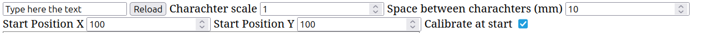

# Text to G-code
### This webpage converts text to g-code 
## What is G-code
G-code is programming language which most of 3d-printers use
## How to use

1. Type text that you want to be converted to g-code
2. Change settings
3. Press "Reload" button
4. See g-code on the demo 
5. Copy the g-code
6. Use the g-code. Use the G-code at your own risk!
## Bugs
    -demo doesn't show text very well
    -Auto copying doesn't always work
    -Calibrating setting doesn't work with all combos
## AI
I used AI to make all of the characters and I used Ai to help fix couple problems BUT I have made all of the code
## Updates
I won't probably update this project because I prefer making other projects
## Characters
There all only UPPER CASE letters from A to Z
## Why I made this
I made this so I can write things on my 3d-printer and because I couldn't find this type of thing from the internet
## Terra
I made this project to Terras week 6
## Why this project looks so good
I made this project to look "bad" because I don't like when there are fancy buttons which doesn't work. I wanted to make this practical not "good looking"
## Inspiration
I was thinking is it possible to write without writing. Then I thought I can code and I have spare 3d-printer so I just made this nice website where I can copy stuff and then have my 3d-printer write it. :D